# Computer Vision – Day 1

A complete, modular, and GitHub-ready implementation of 25 foundational Computer Vision assignments covering basic image manipulation, pixel-level representations, color spaces, statistical properties, sampling, quantization, region cropping, and geometric transformations using **Python**, **OpenCV**, **NumPy**, and **Matplotlib**.

---

## Objective

This repository builds practical mastery over foundational computer vision fundamentals from first principles:
- Understanding how digital images are stored as multi-dimensional matrices in memory.
- Manipulating color spaces (BGR vs. RGB vs. Grayscale) and understanding human perceptual sensitivity.
- Direct mathematical array indexing, channel decomposition, and individual pixel manipulation.
- Statistical image characterization (mean brightness, standard deviation contrast, dynamic range).
- Signal processing operations: spatial sampling, decimation/downsampling, and discrete uniform intensity quantization (4-bit and 2-bit reduction).
- Spatial coordinate transformations: Region of Interest (ROI) slicing and orthogonal matrix rotations.

---

## Technologies Used

- **Python 3.10+**: Core programming language.
- **OpenCV (`cv2`)**: Industry-standard computer vision library for image decoding, color conversion, geometric transformation, and rendering.
- **NumPy**: High-performance multi-dimensional array processing for direct matrix slicing, mathematical statistics, and vectorization.
- **Matplotlib**: Scientific plotting library for color rendering, visualization, and figure exports.

---

## Project Structure

```text
computer-vision-day-1/
│
├── README.md                           # Comprehensive documentation & theory guide
├── requirements.txt                    # Project dependencies
├── .gitignore                          # Ignored caches, temporary files, and artifacts
├── run_all.py                          # Automated test runner verifying all 25 solutions
│
├── input/
│   └── sample.jpg                      # Standard test image (Grace Hopper, 512x600 BGR)
│
├── solutions/
│   ├── Q01_read_display.py             # Read and display image using OpenCV
│   ├── Q02_check_image.py              # Validate file existence and decode success
│   ├── Q03_image_dimensions.py         # Extract height, width, and channels
│   ├── Q04_total_pixels.py             # Calculate spatial pixels vs array elements
│   ├── Q05_image_dtype.py              # Inspect image data type and memory usage
│   ├── Q06_read_save.py                # Read and save under a different filename
│   ├── Q07_grayscale_read.py           # Load image directly in grayscale mode
│   ├── Q08_grayscale_convert.py        # Convert color image to grayscale with cv2.cvtColor
│   ├── Q09_matplotlib_display.py       # Display image via Matplotlib with axes disabled
│   ├── Q10_resize.py                   # Resize image to 50% width and height
│   ├── Q11_pixel_access.py             # Access and inspect pixel at (x, y) coordinates
│   ├── Q12_modify_pixel.py             # Modify pixel intensity and save altered image
│   ├── Q13_bgr_pixel_values.py         # Inspect separate B, G, R values of a selected pixel
│   ├── Q14_split_channels.py           # Split image into separate B, G, R channels
│   ├── Q15_merge_channels.py           # Merge three separate channels into a color image
│   ├── Q16_min_max_intensity.py        # Compute global min and max intensity values
│   ├── Q17_mean_intensity.py           # Compute mean grayscale intensity (brightness)
│   ├── Q18_mean_std.py                 # Compute mean and standard deviation (contrast)
│   ├── Q19_constant_intensity.py       # Generate synthetic 256x256 constant gray (128) image
│   ├── Q20_intensity_ramp.py           # Generate synthetic 256x256 linear gradient ramp (0..255)
│   ├── Q21_4bit_quantization.py        # Quantize 8-bit image to 4-bit (16 levels)
│   ├── Q22_2bit_quantization.py        # Quantize 8-bit image to 2-bit (4 levels)
│   ├── Q23_downsampling.py             # Downsample by factor of 2 in both dimensions
│   ├── Q24_roi_crop.py                 # Crop rectangular Region of Interest (ROI)
│   └── Q25_rotate_90.py                # Rotate image 90 degrees clockwise
│
└── outputs/
    ├── Q01/ ... Q25/                   # Dedicated output folders for each question
```

---

## Installation

1. **Clone the repository**:
   ```bash
   git clone https://github.com/<your-username>/computer-vision-day-1.git
   cd computer-vision-day-1
   ```

2. **Create and activate a virtual environment (optional but recommended)**:
   ```bash
   python -m venv venv
   # On Windows:
   venv\Scripts\activate
   # On macOS/Linux:
   source venv/bin/activate
   ```

3. **Install dependencies**:
   ```bash
   pip install -r requirements.txt
   ```

---

## How to Run

### Run Individual Solutions

Each question is completely self-contained and can be executed individually:

```bash
# Basic Image Handling
python solutions/Q01_read_display.py
python solutions/Q02_check_image.py
python solutions/Q03_image_dimensions.py
python solutions/Q04_total_pixels.py
python solutions/Q05_image_dtype.py
python solutions/Q06_read_save.py
python solutions/Q07_grayscale_read.py
python solutions/Q08_grayscale_convert.py
python solutions/Q09_matplotlib_display.py
python solutions/Q10_resize.py

# Pixel & Image Representation
python solutions/Q11_pixel_access.py
python solutions/Q12_modify_pixel.py
python solutions/Q13_bgr_pixel_values.py
python solutions/Q14_split_channels.py
python solutions/Q15_merge_channels.py
python solutions/Q16_min_max_intensity.py
python solutions/Q17_mean_intensity.py
python solutions/Q18_mean_std.py
python solutions/Q19_constant_intensity.py
python solutions/Q20_intensity_ramp.py

# Sampling, Quantization & Geometric Operations
python solutions/Q21_4bit_quantization.py
python solutions/Q22_2bit_quantization.py
python solutions/Q23_downsampling.py
python solutions/Q24_roi_crop.py
python solutions/Q25_rotate_90.py
```

> **Note on Display Windows**: All scripts check for interactive vs. headless environments. When run interactively, images are displayed in windows (`cv2.imshow` or `plt.show`). To run without GUI popups (e.g., in automated testing or CI), simply pass the `--headless` flag or set environment variable `HEADLESS=1`.

### Run All 25 Solutions Automatically

To execute all 25 solutions in sequence and verify all generated image and text outputs:
```bash
python run_all.py
```

---

## Questions Covered

| Question | Topic | Solution File | Primary Output(s) | Description |
| :--- | :--- | :--- | :--- | :--- |
| **Q01** | Basic Handling | [`solutions/Q01_read_display.py`](solutions/Q01_read_display.py) | `outputs/Q01/Q01_original_image.png` | Read image using `cv2.imread()`, display, and save. |
| **Q02** | Basic Handling | [`solutions/Q02_check_image.py`](solutions/Q02_check_image.py) | `outputs/Q02/Q02_result.txt` | Verify image load success and print informative error handling. |
| **Q03** | Basic Handling | [`solutions/Q03_image_dimensions.py`](solutions/Q03_image_dimensions.py) | `outputs/Q03/Q03_result.txt` | Extract height (rows), width (cols), and channel count via `img.shape`. |
| **Q04** | Basic Handling | [`solutions/Q04_total_pixels.py`](solutions/Q04_total_pixels.py) | `outputs/Q04/Q04_result.txt` | Calculate spatial pixel count ($H \times W$) vs total array elements ($H \times W \times C$). |
| **Q05** | Basic Handling | [`solutions/Q05_image_dtype.py`](solutions/Q05_image_dtype.py) | `outputs/Q05/Q05_result.txt` | Inspect NumPy `dtype` (`uint8`) and total memory footprint (`nbytes`). |
| **Q06** | Basic Handling | [`solutions/Q06_read_save.py`](solutions/Q06_read_save.py) | `outputs/Q06/Q06_saved_image.png` | Read image and write with different filename/format using `cv2.imwrite()`. |
| **Q07** | Basic Handling | [`solutions/Q07_grayscale_read.py`](solutions/Q07_grayscale_read.py) | `outputs/Q07/Q07_grayscale.png` | Load image directly into single-channel grayscale via `cv2.IMREAD_GRAYSCALE`. |
| **Q08** | Basic Handling | [`solutions/Q08_grayscale_convert.py`](solutions/Q08_grayscale_convert.py) | `outputs/Q08/Q08_grayscale_converted.png` | Convert 3-channel BGR to grayscale using `cv2.cvtColor()` luminance weighting. |
| **Q09** | Basic Handling | [`solutions/Q09_matplotlib_display.py`](solutions/Q09_matplotlib_display.py) | `outputs/Q09/Q09_matplotlib_output.png` | Convert BGR to RGB, plot with Matplotlib, and hide coordinate axes. |
| **Q10** | Basic Handling | [`solutions/Q10_resize.py`](solutions/Q10_resize.py) | `outputs/Q10/Q10_resized.png` | Downscale image to 50% width and height using `cv2.INTER_AREA`. |
| **Q11** | Representation | [`solutions/Q11_pixel_access.py`](solutions/Q11_pixel_access.py) | `outputs/Q11/Q11_result.txt` | Access pixel at user coordinate $(x, y)$ via row-column indexing `img[y, x]`. |
| **Q12** | Representation | [`solutions/Q12_modify_pixel.py`](solutions/Q12_modify_pixel.py) | `outputs/Q12/Q12_modified_pixel.png` | Mutate pixel value to yellow and highlight the local neighborhood patch. |
| **Q13** | Representation | [`solutions/Q13_bgr_pixel_values.py`](solutions/Q13_bgr_pixel_values.py) | `outputs/Q13/Q13_result.txt` | Extract and print individual Blue, Green, and Red intensity components. |
| **Q14** | Representation | [`solutions/Q14_split_channels.py`](solutions/Q14_split_channels.py) | `outputs/Q14/Q14_blue_channel.png`<br>`outputs/Q14/Q14_green_channel.png`<br>`outputs/Q14/Q14_red_channel.png` | Split color image into 3 distinct single-channel intensity images. |
| **Q15** | Representation | [`solutions/Q15_merge_channels.py`](solutions/Q15_merge_channels.py) | `outputs/Q15/Q15_merged.png` | Recombine B, G, R channels using `cv2.merge()` and verify lossless reconstruction. |
| **Q16** | Representation | [`solutions/Q16_min_max_intensity.py`](solutions/Q16_min_max_intensity.py) | `outputs/Q16/Q16_result.txt` | Calculate global min/max intensity and coordinate locations via `cv2.minMaxLoc()`. |
| **Q17** | Representation | [`solutions/Q17_mean_intensity.py`](solutions/Q17_mean_intensity.py) | `outputs/Q17/Q17_result.txt` | Calculate overall image mean brightness using `cv2.mean()` and `np.mean()`. |
| **Q18** | Representation | [`solutions/Q18_mean_std.py`](solutions/Q18_mean_std.py) | `outputs/Q18/Q18_result.txt` | Calculate mean and standard deviation (contrast measure) using `cv2.meanStdDev()`. |
| **Q19** | Representation | [`solutions/Q19_constant_intensity.py`](solutions/Q19_constant_intensity.py) | `outputs/Q19/Q19_constant_128.png` | Synthesize a $256 \times 256$ uniform mid-gray matrix with constant intensity 128. |
| **Q20** | Representation | [`solutions/Q20_intensity_ramp.py`](solutions/Q20_intensity_ramp.py) | `outputs/Q20/Q20_intensity_ramp.png` | Synthesize a $256 \times 256$ smooth horizontal intensity ramp from 0 to 255. |
| **Q21** | Quantization | [`solutions/Q21_4bit_quantization.py`](solutions/Q21_4bit_quantization.py) | `outputs/Q21/Q21_4bit_quantized.png` | Reduce 8-bit (256 levels) to 4-bit (16 levels) with step size $\Delta = 16$. |
| **Q22** | Quantization | [`solutions/Q22_2bit_quantization.py`](solutions/Q22_2bit_quantization.py) | `outputs/Q22/Q22_2bit_quantized.png` | Reduce 8-bit (256 levels) to 2-bit (4 levels) with step size $\Delta = 64$. |
| **Q23** | Sampling | [`solutions/Q23_downsampling.py`](solutions/Q23_downsampling.py) | `outputs/Q23/Q23_downsampled.png`<br>`outputs/Q23/Q23_resolution.txt` | Decimate image by factor 2 along both axes via `img[::2, ::2]`. |
| **Q24** | Geometric | [`solutions/Q24_roi_crop.py`](solutions/Q24_roi_crop.py) | `outputs/Q24/Q24_roi.png`<br>`outputs/Q24/Q24_roi_with_bounding_box.png` | Crop rectangular Region of Interest (ROI) via slice `img[y1:y2, x1:x2]`. |
| **Q25** | Geometric | [`solutions/Q25_rotate_90.py`](solutions/Q25_rotate_90.py) | `outputs/Q25/Q25_rotated_90.png` | Orthogonal 90-degree clockwise rotation via `cv2.rotate()`. |

---

## Core Computer Vision Concepts Learned

### 1. Digital Image Representation & Memory Layout
A digital image is discretized both spatially (sampling) and in intensity (quantization). In Python, an image is represented as a contiguous NumPy N-dimensional array (`ndarray`):
- A grayscale image is a 2D matrix of shape $(H, W)$ where $H$ is the number of rows (height) and $W$ is the number of columns (width).
- A color image is a 3D tensor of shape $(H, W, C)$ where $C$ is the number of color channels.

### 2. Matrix Indexing Convention: $(y, x)$ vs $(x, y)$
A frequent point of confusion in computer vision is coordinate order:
- **Cartesian / Geometry / OpenCV functions**: Represent coordinates as $(x, y)$ where $x$ is horizontal distance (columns) and $y$ is vertical distance (rows). Examples: `cv2.resize(img, (width, height))`, `cv2.rectangle(img, (x1, y1), (x2, y2), ...)`.
- **NumPy Matrix Indexing**: Represented as `matrix[row, column] = matrix[y, x]`.
- Always remember: `img[y, x]` accesses the pixel at column $x$ and row $y$.

### 3. BGR vs. RGB Color Spaces
- Standard photographic formats (JPEG, PNG, web graphics) use **RGB** (Red, Green, Blue).
- **OpenCV loads color images in BGR order by default** due to legacy hardware frame grabber conventions.
- When passing OpenCV images to Matplotlib, they must be converted using `cv2.cvtColor(img, cv2.COLOR_BGR2RGB)`, otherwise red and blue channels are inverted (e.g., human faces appear blue/cyan).

### 4. Grayscale Conversion & Human Eye Luminance Sensitivity
Human eyes do not perceive all wavelengths of light with equal sensitivity. The human retina is heavily packed with M and L cone cells, making us most sensitive to green light and least sensitive to blue. OpenCV implements the ITU-R BT.601 standard for RGB-to-grayscale conversion:
$$\text{Gray} = 0.299 \cdot R + 0.587 \cdot G + 0.114 \cdot B$$
Notice that Green accounts for nearly 59% of the perceived brightness, while Blue accounts for only 11.4%.

### 5. Data Types (`dtype`) and Dynamic Range
- Standard 8-bit images use `numpy.uint8`: unsigned integers ranging from 0 ($2^0 - 1$) to 255 ($2^8 - 1$).
- Overflows wrap around in standard modular arithmetic (`uint8(255) + 1 = 0`), whereas OpenCV saturation arithmetic clips to 255 (`cv2.add()`).
- Floating-point representations (`float32`, `float64`) are used in linear filtering, frequency domain (FFT), and deep learning networks, typically normalized to $[0.0, 1.0]$.

### 6. Statistical Analysis: Mean & Standard Deviation
- **Mean Intensity ($\mu$)**: Indicates average brightness:
  $$\mu = \frac{1}{N} \sum_{i=1}^{N} I_i$$
- **Standard Deviation ($\sigma$)**: Measures the spread of intensity values around the mean:
  $$\sigma = \sqrt{\frac{1}{N} \sum_{i=1}^{N} (I_i - \mu)^2}$$
- In computer vision, standard deviation directly correlates with **image contrast**:
  - High $\sigma$: High contrast with rich blacks, crisp whites, and distinct mid-tones.
  - Low $\sigma$: Low contrast (foggy, washed-out, or poorly illuminated scene).

### 7. Spatial Sampling and Downsampling
- **Spatial Sampling**: The process of digitizing continuous spatial coordinates into a discrete grid of pixels.
- **Downsampling (Decimation)**: Selecting every $k$-th sample along each axis (`img[::2, ::2]`).
- Downsampling by a factor of 2 along both width and height reduces the total spatial pixel count by a factor of $2 \times 2 = 4$ ($75\%$ reduction in data volume).

### 8. Intensity Quantization & False Contouring
Quantization converts continuous (or high-depth) intensity values into a discrete set of finite levels:
- **8-bit Image**: $2^8 = 256$ intensity levels ($0 \dots 255$).
- **4-bit Quantization**: $2^4 = 16$ levels. Bin width $\Delta = 256 / 16 = 16$.
  Level $q = \lfloor I / 16 \rfloor$. Rescaled to 8-bit display via $q \times 17 \in \{0, 17, 34, \dots, 255\}$.
- **2-bit Quantization**: $2^2 = 4$ levels. Bin width $\Delta = 256 / 4 = 64$.
  Level $q = \lfloor I / 64 \rfloor$. Rescaled to 8-bit display via $q \times 85 \in \{0, 85, 170, 255\}$.
- **False Contouring / Posterization**: When quantization levels are drastically reduced, smoothly transitioning gradients turn into sharp, artificial step boundaries (visible banding).

### 9. Region of Interest (ROI)
A Region of Interest is an isolated rectangular sub-window of an image. In OpenCV and NumPy, cropping is implemented via matrix slice notation:
$$\text{ROI} = \text{img}[y_1 : y_2, \, x_1 : x_2]$$
where $(x_1, y_1)$ is the top-left coordinate and $(x_2, y_2)$ is the bottom-right coordinate.

### 10. Orthogonal Rotation (90 Degrees)
Rotating an image by 90 degrees clockwise involves two underlying matrix operations:
1. **Matrix Transpose**: Swaps rows and columns ($A^T$).
2. **Horizontal Reflection**: Mirrors columns across the vertical center axis (`cv2.flip(transposed, 1)`).
OpenCV provides the optimized function `cv2.rotate(img, cv2.ROTATE_90_CLOCKWISE)` to execute this without interpolation loss.

---

## Output Examples

Below are representative outputs generated by the assignment solutions:

### Original Image vs. Grayscale Conversions
| Original Image (Q01) | Grayscale via Direct Read (Q07) | Grayscale via cv2.cvtColor (Q08) |
| :---: | :---: | :---: |
| 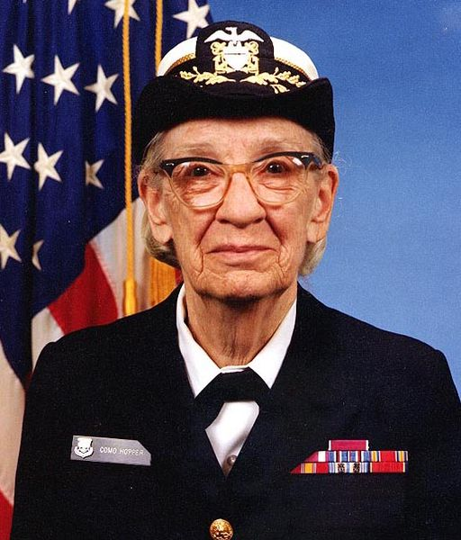 | 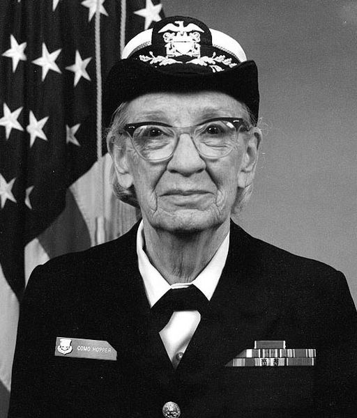 |  |

---

### Channel Decomposition (Q14) & Lossless Re-Merge (Q15)
| Blue Channel | Green Channel | Red Channel | Reconstructed Merged Image |
| :---: | :---: | :---: | :---: |
| 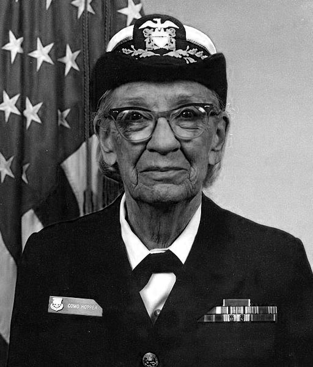 | 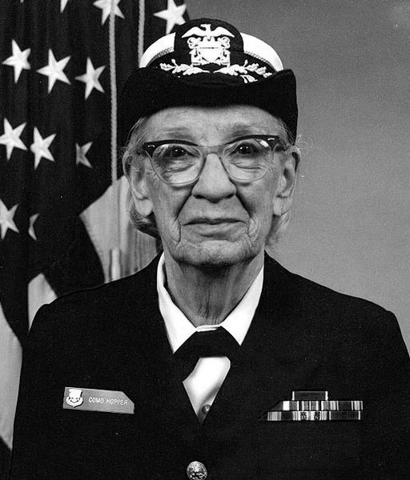 | 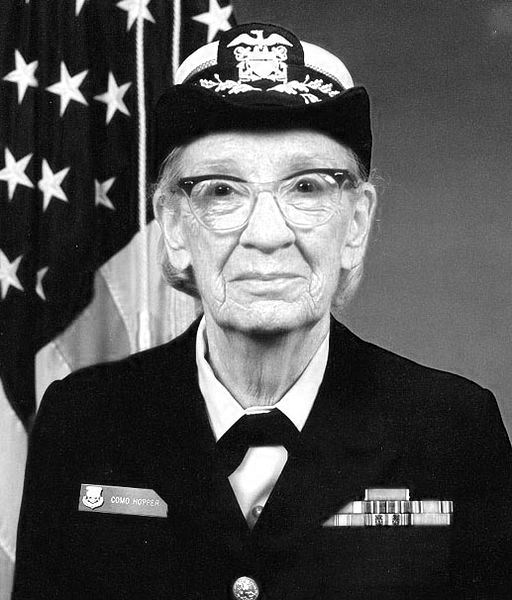 |  |

---

### Synthetic Image Generation
| Constant Intensity 128 (Q19) | Linear Intensity Ramp 0–255 (Q20) |
| :---: | :---: |
| 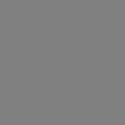 | 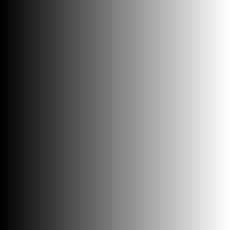 |

---

### Quantization Comparison: Bit-Depth Reduction
Observe how reducing quantization levels introduces progressive false contouring and posterization:

| 8-bit Original Grayscale (256 Levels) | 4-bit Quantized (16 Discrete Levels) (Q21) | 2-bit Quantized (4 Discrete Levels) (Q22) |
| :---: | :---: | :---: |
|  |  | 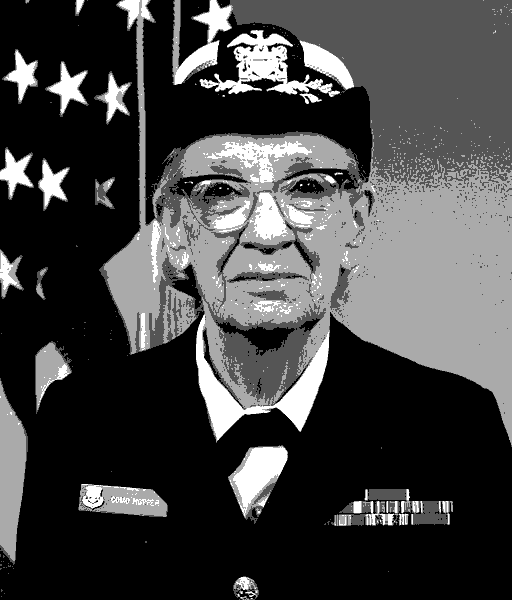 |

---

### Geometric Operations: Sampling, ROI Cropping, and Rotation
| Cropped Face ROI (Q24) | ROI Bounding Box Context (Q24) | 90° Clockwise Rotated (Q25) |
| :---: | :---: | :---: |
| 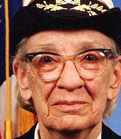 | 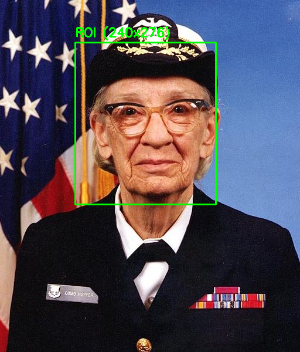 | 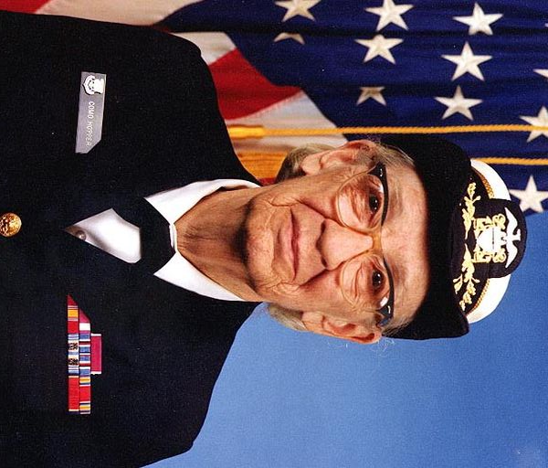 |

---

## Verification & Automated Testing

To ensure full compliance and reliability, run the master test runner:
```bash
python run_all.py
```

Expected output:
```text
======================================================================
Executing All 25 Computer Vision Assignment Solutions
======================================================================
[01/25] Running Q01_read_display.py... OK [PASSED]
[02/25] Running Q02_check_image.py... OK [PASSED]
...
[25/25] Running Q25_rotate_90.py... OK [PASSED]
======================================================================
SUMMARY: 25 Solutions Executed in 18.15 seconds
Total Passed: 25 / 25
ALL 25 QUESTIONS COMPLETED AND VERIFIED SUCCESSFULLY!
```

---

## License

This project is created for educational and academic submission purposes under the MIT License.
